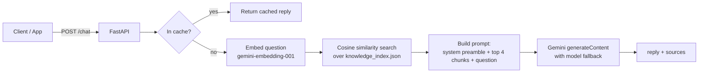

# ElectraGuard Chatbot (RAG) — FastAPI Backend

A FastAPI backend for the **ElectraGuard** chatbot, an electricity theft detection and consumer-support app for Pakistan. It answers user questions with **Google Gemini**, grounded in a knowledge base built from Pakistani power-sector sources (DISCOs, NEPRA, WAPDA, K-Electric) using **Retrieval-Augmented Generation (RAG)**.

This is a Python/FastAPI port of the original Node.js/Express backend, with added protection against Gemini free-tier quota errors (`429 RESOURCE_EXHAUSTED`).

---

## Table of Contents

- [Features](#features)
- [How It Works](#how-it-works)
- [Project Structure](#project-structure)
- [Tech Stack](#tech-stack)
- [Getting Started (Local)](#getting-started-local)
- [Configuration](#configuration)
- [API Reference](#api-reference)
- [Handling Gemini Quota Errors](#handling-gemini-quota-errors)
- [Updating the Knowledge Base](#updating-the-knowledge-base)
- [Deploying on Render](#deploying-on-render)
- [Keep-Alive (Free Tier)](#keep-alive-free-tier)
- [Testing the API](#testing-the-api)
- [Troubleshooting](#troubleshooting)
- [Security Notes](#security-notes)

---

## Features

- **RAG pipeline**: embeds the user's question, finds the most relevant chunks of the knowledge base, and gives them to Gemini as context.
- **Source attribution**: every answer includes a `sources` list (for example `["lesco_home", "nepra_home"]`).
- **Quota-aware**: automatic fallback across multiple Gemini models, per-model cooldowns, and a degraded mode that still returns official excerpts when all quota is used up.
- **Caching**: repeated questions don't spend Gemini requests (case and whitespace are normalised).
- **Rate limiting**: 100 requests per minute per IP on `/chat`.
- **Frontend-compatible**: errors use the `{"error": "..."}` shape; both JSON and URL-encoded bodies are accepted; CORS is open.
- **Built-in keep-alive**: optional self-ping so Render's free tier doesn't put the service to sleep.
- **Interactive docs**: Swagger UI at `/docs`.

---

## How It Works



1. The question is normalised and checked against an in-memory cache.
2. It is embedded with `gemini-embedding-001` (768 dimensions).
3. The embedding is compared against the pre-built index using cosine similarity. Only chunks scoring **0.55 or higher** are used, and at most the top 4.
4. The chunks and the question are sent to Gemini. If no chunk matches, the bot answers from general knowledge and says it isn't quoting an official source.
5. The response `{ reply, sources }` is returned and cached (up to 100 entries).

---

## Project Structure

```
.
├── main.py                  # FastAPI app: routes, CORS, rate limit, cache, keep-alive
├── gemini_client.py         # Async Gemini REST client, model fallback, quota handling
├── rag_engine.py            # Loads the index and runs vector search (numpy)
├── requirements.txt         # Python dependencies for the server
├── .env.example             # Template for environment variables
├── .gitignore
├── .github/
│   └── workflows/
│       └── keepalive.yml    # Optional GitHub Action that pings the server
└── rag/
    ├── index/
    │   └── knowledge_index.json   # Chunked + embedded knowledge (loaded at startup)
    ├── knowledge_base/            # Raw scraped .txt files (one per source page)
    ├── scripts/
    │   ├── scrape_sources.py      # Scrapes utility/regulator pages
    │   ├── build_index.py         # Chunks + embeds the text into the index
    │   └── requirements.txt       # Dependencies for the scripts (not the server)
    └── README.md                  # Notes on the RAG data pipeline
```

---

## Tech Stack

| Component | Technology |
|-----------|------------|
| Web framework | FastAPI + Uvicorn |
| HTTP client | httpx (async) |
| Vector search | numpy (cosine similarity, in memory) |
| LLM | Google Gemini (`generateContent`) |
| Embeddings | `gemini-embedding-001` (768-dim) |
| Config | python-dotenv |
| Hosting | Render |

---

## Getting Started (Local)

### Prerequisites

- Python 3.10 or newer
- A Gemini API key from [Google AI Studio](https://aistudio.google.com/)

### 1. Clone and install

```bash
git clone https://github.com/MuhammadAsadKhan-11/ElectraGuard_chatbot_rag.git
cd ElectraGuard_chatbot_rag
python -m venv .venv
```

Activate the virtual environment:

```powershell
# Windows (PowerShell)
.venv\Scripts\Activate.ps1
```

```bash
# macOS / Linux
source .venv/bin/activate
```

Then install the dependencies:

```bash
pip install -r requirements.txt
```

### 2. Configure

```bash
cp .env.example .env          # Windows: copy .env.example .env
```

Open `.env` and set your real `GEMINI_API_KEY` (see [Configuration](#configuration)).

### 3. Run

```bash
python -m uvicorn main:app --host 0.0.0.0 --port 5000
```

On Windows, use `python -m uvicorn` instead of plain `uvicorn`, since the `uvicorn` command may not be on your PATH.

You should see `RAG: loaded 215 chunks from knowledge_index.json` followed by `Application startup complete`. Then open:

- http://localhost:5000/ — health check
- http://localhost:5000/docs — interactive API docs

---

## Configuration

All settings are environment variables (loaded from `.env` locally, or from the dashboard on Render).

| Variable | Required | Default | Description |
|----------|----------|---------|-------------|
| `GEMINI_API_KEY` | Yes | — | Your Google Gemini API key. |
| `PORT` | No | `5000` | Port used by `python main.py` (Render sets this automatically). |
| `GENERATION_MODELS` | No | `gemini-3.5-flash` | Comma-separated Gemini models, tried in order. If one hits its quota, the next is used. |
| `DEGRADED_FALLBACK` | No | `true` | If every model is out of quota, return the best official excerpt instead of an error. |
| `KEEPALIVE_URL` | No | the original Render URL | URL the server pings every 10 minutes. Set it to your own service URL, or leave it empty to disable. |
| `EMBED_MODEL` | No | `gemini-embedding-001` | Embedding model. It must match the one used to build the index. |

Example `.env`:

```env
GEMINI_API_KEY=your_key_here
PORT=5000
GENERATION_MODELS=gemini-3.5-flash,gemini-3.6-flash
DEGRADED_FALLBACK=true
KEEPALIVE_URL=https://your-service.onrender.com
```

---

## API Reference

### `GET /`

Health check. Returns plain text: `Gemini + RAG backend is running 🚀`.

### `POST /chat`

Ask the chatbot a question.

**Request body** (JSON, or `application/x-www-form-urlencoded`):

```json
{ "message": "How do I report electricity theft?" }
```

| Field | Type | Rules |
|-------|------|-------|
| `message` | string | Required, at most 2000 characters |

**Success response** — `200 OK`:

```json
{
  "reply": "To report electricity theft, contact your local DISCO...",
  "sources": ["lesco_home", "nepra_home"]
}
```

`sources` is empty when no knowledge-base chunk matched the question.

**Degraded response** — `200 OK`, only when all Gemini quota is exhausted and a relevant chunk exists:

```json
{
  "reply": "The AI service is temporarily at its usage limit, so here is the most relevant information from official sources: ...",
  "sources": ["lesco_home"],
  "degraded": true
}
```

**Error responses** (always `{ "error": "..." }`):

| Status | `error` | Meaning |
|--------|---------|---------|
| 400 | `Message required` | Missing, empty, or non-string `message` |
| 400 | `Message too long.` | More than 2000 characters |
| 429 | `Too many requests. Please wait.` | More than 100 requests per minute from one IP |
| 429 | `Gemini quota exceeded. Please try again later.` | All models out of quota and no fallback available. Includes a `Retry-After` header when Google provides the wait time. |
| 500 | `Server error` | Missing API key, Gemini failure, or network error. Check the server logs. |

---

## Handling Gemini Quota Errors

The free tier of the Gemini API has low per-model daily limits (for example 20 `generateContent` requests per day). When exceeded, Google returns `429 RESOURCE_EXHAUSTED`. Rewriting the backend in another language doesn't change this limit, so the project handles it in these ways:

1. **Model fallback**: list several models in `GENERATION_MODELS`. Each model has its own quota, so when one is exhausted the next one is tried.
2. **Per-model cooldown**: after a 429, a model is skipped until Google's suggested retry time passes (capped at 1 hour), which avoids wasting a call on every request.
3. **Short-wait retry**: if Google asks to retry within about 5 seconds (per-minute limits), the request waits and retries the same model once.
4. **Caching**: repeated questions, ignoring case and extra whitespace, are served from memory. Question embeddings are cached too.
5. **Graceful embedding failure**: if the embedding call fails, the question is still answered, just without retrieved context.
6. **Degraded mode**: if every model is exhausted, the API returns the best matching official excerpt (`"degraded": true`) instead of an error.

**The permanent fix** is to enable billing on the Google AI project that owns your API key. Each `/chat` request on a cache miss uses two Gemini calls (embedding and generation), so the free tier runs out quickly.

---

## Updating the Knowledge Base

The bot's knowledge lives in `rag/index/knowledge_index.json`, built in two steps. Run these **on your own machine** (not on Render), since they need internet access to the source sites.

```bash
cd rag/scripts
pip install -r requirements.txt

# 1. Scrape the pages listed in SOURCES inside scrape_sources.py
python scrape_sources.py

# 2. Chunk + embed the text (needs GEMINI_API_KEY)
export GEMINI_API_KEY=your_key_here        # Windows: $env:GEMINI_API_KEY="your_key_here"
python build_index.py
```

Then commit the updated `rag/index/knowledge_index.json` and push so Render redeploys with it.

Notes:

- To add sources, append `(name, url)` entries to `SOURCES` in `scrape_sources.py`, or drop extra `.txt` files into `rag/knowledge_base/` by hand (for example, text extracted from a PDF tariff schedule).
- `build_index.py` is resumable. If it's rate-limited partway, run it again and already-embedded chunks are skipped.
- Chunks are about 400 words with a 60-word overlap, embedded at 768 dimensions. The server reads `EMBED_DIMENSIONS = 768`, so don't change one without the other.
- Utility and government pages change often. Re-run the scripts periodically, and check each site's terms and `robots.txt` before scraping.
- The current knowledge base is mostly utility home pages. For reliable answers on penalties, fines, or tariffs, add the official NEPRA rules and schedules as text files and rebuild the index.

---

## Deploying on Render

1. Push this repo to GitHub (make sure `.env` is **not** committed).
2. In Render, choose **New → Web Service** and connect the repo.
3. Use these settings:

| Setting | Value |
|---------|-------|
| Runtime | Python 3 |
| Build command | `pip install -r requirements.txt` |
| Start command | `python -m uvicorn main:app --host 0.0.0.0 --port $PORT` |

4. Under **Environment**, add:
   - `GEMINI_API_KEY` (required)
   - `KEEPALIVE_URL` set to your service's own `https://...onrender.com` URL
   - optionally `GENERATION_MODELS` and `PYTHON_VERSION` (for example `3.12.3`) if the build has Python version problems
5. Deploy, then test with the commands in [Testing the API](#testing-the-api).

The first request after a deploy or idle period can take 30 to 60 seconds on the free tier while the service wakes up.

---

## Keep-Alive (Free Tier)

Render's free tier puts a service to sleep after about 15 minutes without traffic. Two mechanisms are included:

- **Built-in self-ping**: `main.py` requests `KEEPALIVE_URL` every 10 minutes while the server is running. Set it to your own service URL, or leave it empty to disable it.
- **GitHub Action** (`.github/workflows/keepalive.yml`): a scheduled workflow that runs `curl` against your URL every 10 minutes. It can wake a service that has already gone to sleep. Edit the URL in the file to match your service. GitHub may delay scheduled runs and pauses them after 60 days without repo activity.

Using both is the most reliable setup. You can test the workflow any time from the **Actions** tab with **Run workflow**.

---

## Testing the API

**PowerShell**

```powershell
Invoke-RestMethod -Uri http://localhost:5000/chat -Method Post `
  -ContentType "application/json" `
  -Body '{"message":"How do I report electricity theft?"}'
```

**curl (macOS / Linux / Git Bash)**

```bash
curl -X POST http://localhost:5000/chat \
  -H "Content-Type: application/json" \
  -d '{"message":"What is net metering?"}'
```

You can also use the Swagger UI at `/docs`. For a live deployment, replace `http://localhost:5000` with your Render URL.

---

## Troubleshooting

| Symptom | Likely cause and fix |
|---------|---------------------|
| `uvicorn` is not recognized (Windows) | Run it as `python -m uvicorn main:app ...`. |
| Connection refused on `localhost:5000` | The server isn't running. Start it first and keep that window open. |
| `500 Server error` and log says `GEMINI_API_KEY is not set` | The `.env` file is missing, misnamed (`.env.txt`), or not next to `main.py`. Fix it and restart. |
| Log shows `Gemini error 404` or `400` | The model name in `GENERATION_MODELS` isn't available for your key. Try another model name. |
| Log shows `Gemini error 403` | The API key is invalid, revoked, or restricted. Create a new key. |
| `429 Gemini quota exceeded` | Free-tier quota is used up. Add more models to `GENERATION_MODELS`, wait for the reset, or enable billing. |
| Answers have no `sources` | No chunk scored 0.55 or higher for that question, or `knowledge_index.json` is missing (check the startup log). |
| Render service keeps sleeping | Check that `KEEPALIVE_URL` and the GitHub Action URL point to the **current** service URL. |
| `dubious ownership` git error | Run `git config --global --add safe.directory "<path to the project folder>"`. |

---

## Security Notes

- **Never commit `.env`.** It is listed in `.gitignore`. If a real key was ever committed or shared, rotate it in Google AI Studio.
- The API key is sent to Google in a request header and is not written to the logs.
- CORS is currently open to all origins (`*`). Restrict `allow_origins` in `main.py` before going to production if you know your frontend's domain.
- The in-memory cache and rate limiter reset whenever the service restarts and are per-instance. That is fine for a single Render instance; use a shared store such as Redis if you scale to several.
- Scraped content belongs to the respective utility and government sites. Use it as reference data for grounding answers, not as content to republish.
